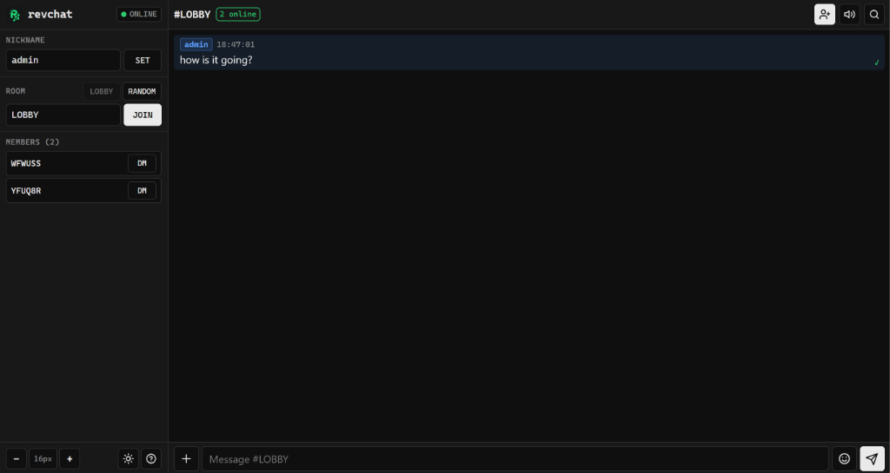

# revchat

Minimal, ephemeral P2P web chat.

> We live in an era where chasing wealth has become the default.  
> Yet behind excessive wealth, there is always someone's pain.  
> Let us choose genuine happiness and love instead.  
> revchat is built to connect people freely, as equals.



## Features

- **Hostless P2P Mesh**: Connects peers directly via WebRTC (`trystero` over multi-relay Nostr signaling + same-browser `BroadcastChannel` fallback) — no central chat server, no database, and zero server logs.
- **End-to-End Encryption & Signing**: Negotiates per-session WebCrypto ECDH keys, encrypts direct/room traffic with AES-256-GCM, and signs outgoing packets with ECDSA.
- **Instant Room Join**: Enter `#LOBBY`, type any shared room code, or generate a `RANDOM` room code and share the URL hash link (`#room=...`) or scannable QR code via **INVITE**.
- **P2P Media & Voice Notes**: Send files, auto-compressed images, videos, and recorded voice notes up to 25 MB with progress tracking and cancellation. Open `.pdf` and `.txt` attachments directly in-browser with UTF-8/CP949 charset auto-detection.
- **WebRTC Room Calls**: Built-in audio/video calls, camera toggle/flip, screen sharing, theater/fullscreen view, volume control, and a persistent remote audio pool.

## How It Works

- **Signaling vs. Data**: Public Nostr relays only broker encrypted WebRTC SDP offers/answers and ICE candidates to establish peer connections. Once connected, all chat messages, calls, and files flow directly peer-to-peer over WebRTC DataChannels/MediaStreams (or `BroadcastChannel` across tabs in the same browser).
- **Ephemeral by Design**: Rooms and messages live only in active browser memory. Closing the last tab leaves nothing behind on any server.
- **Hardened Client**: Enforces a strict Content Security Policy (`index.html`) and sanitizes incoming packets, filenames, URLs, and Markdown DOM output before rendering.

## Quick Start

Requires **Node.js >= 22.14.0**.

```bash
npm install
npm run dev      # Start local Vite dev server
npm test         # Run Vitest unit & crypto tests
npm run build    # Type-check and build production bundle to dist/
```
